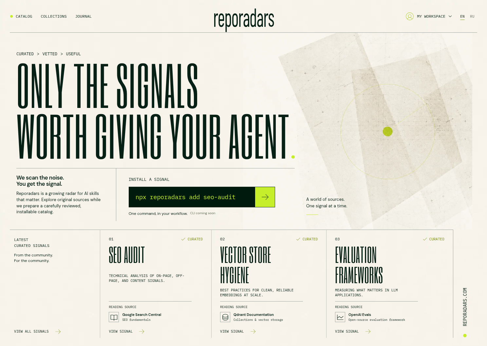

# Reporadars

[](https://github.com/Astraforge-AI/reporadars.com/actions/workflows/ci.yml)

**A reference-led radar for practical AI skills.** Reporadars is an editorial web library for reading draft instructions, tracing their sources, and keeping a personal shortlist while an installable catalog is still being prepared.

[Visit Reporadars](https://reporadars.com) · [Русская версия](https://reporadars.com/ru) · [Contributing](CONTRIBUTING.md) · [Architecture](docs/architecture.md)



## What is here

- A browseable library of **8 draft skills** with detail pages and downloadable Markdown drafts.
- **3 editorial collections** to explore related topics together.
- A local workspace for saved skills and a small profile, kept in the browser rather than on a server.
- A Signal Journal with clearly labeled **sample** editorial entries.
- English and Russian routes, including locale-preserving navigation.

Drafts link to their reference material and state their scope. They are working material, not claims of independent vetting, publisher endorsement, or compatibility certification.

## Current boundaries

Reporadars is a public reading and exploration experience today:

- The `reporadars` CLI is not published yet.
- Email sign-in has a [locally tested backend and confirmation flow](docs/email-auth.md), separate from the static website. Production authentication is not activated; GitHub login and cloud synchronization remain unavailable.
- Saved skills and profile fields are local to the current browser. Cloud sync is not configured.
- Journal entries are editorial samples, not a release history.

## Quick start

No `.env` file is needed for a local run. Use Node.js 22 or later.

```sh
git clone https://github.com/Astraforge-AI/reporadars.com.git
cd reporadars.com
npm ci
npm run dev
```

Build and inspect the generated local preview:

```sh
npm run build
node scripts/homepage-preview.mjs
```

The canonical verification command is:

```sh
make verify
```

Browser checks use `/usr/bin/chromium` when it is available, or a `CHROMIUM_PATH` override. On platforms without a system Chromium, install Playwright's browser and point `CHROMIUM_PATH` at its executable:

```sh
npx playwright install chromium
# Set CHROMIUM_PATH to the path returned by chromium.executablePath().
```

## Project map

| Path       | Purpose                                                                          |
| ---------- | -------------------------------------------------------------------------------- |
| `src/`     | Next.js frontend, page components, content registry, localization, and browser workspace |
| `public/`  | Static visual assets                                                             |
| `scripts/` | Static rendering, local preview, and capture helpers                             |
| `tests/`   | Browser and Worker-facing checks                                                 |
| `worker/`  | Sites `ASSETS` entrypoint, separate from the custom Cloudflare Worker            |
| `.openai/` | Sites handoff configuration                                                      |

The build produces two distinct delivery artifacts. `dist/reporadars.worker.mjs` is the custom Cloudflare Worker with prerendered pages and a bounded origin fallback; the local built preview uses this artifact. `dist/server/index.js` is a separate Sites `ASSETS` adapter with an HTML app-shell fallback, packaged with `dist/client/` and `dist/.openai/hosting.json`. Their routing and fallback behavior are not interchangeable. Read the [architecture note](docs/architecture.md) before choosing a deployment handoff.

## Contributing

Content improvements are welcome, especially source corrections, clearer scope, and translations that preserve the meaning of command and skill identifiers. Please read [CONTRIBUTING.md](CONTRIBUTING.md) before opening a change.

## Локально — кратко

Сайт доступен на [reporadars.com/ru](https://reporadars.com/ru). Для локального запуска достаточно Node.js 22+, `npm ci` и `npm run dev`; `.env` не требуется. Каталог и журнал содержат черновики и демонстрационные материалы: CLI, реальные входы через провайдеров и облачная синхронизация пока не настроены.

## License

A project license has not been selected yet. Third-party dependency and font licensing remains with the corresponding packages and their included metadata.
